<p align="center">
  <picture>
    <source media="(prefers-color-scheme: dark)" srcset="assets/emblem/archie-ledge-rim-light.svg">
    
  </picture>
</p>

# antiq

Your idle folders, kept like antiques.

Many developers have a folder where experiments pile up: spikes,
half-finished tools, a clone made to check one thing. The same happens in
the context directories of AI conversations and coding agents, where every
run leaves transcripts, intermediate files and scratch output you may want
again. You do not delete them, so they stay, and the folder grows.

antiq turns such a folder into a collection. A folder of it that nobody has
touched for 30 days (the default, configurable) is packed into a `tar.zst`
archive, read back and compared with the folder, and only then removed. You
find it again by the name of the folder or by the path of a file it held,
and bring it back. The whole collection, live folders and versions, can be
mirrored to one target with rsync.


antiq runs on macOS and Linux. Everything it writes can be read without it:
archives are `tar.zst` files, and a listing is a checksum list that
`shasum -c` reads once `zstd` has decompressed it.

## Where it helps

- **The folder where your experiments pile up.** Whatever its name, a
  folder with one subfolder per experiment is a collection. Old
  experiments leave the folder, and the search by name or by file finds
  them again.
- **The context directories of AI conversations and agent work.** Each run
  of a coding agent or each conversation leaves a folder of transcripts and
  intermediate data. A [pattern](#which-folders-are-pieces) in the
  collection's configuration selects whichever folders your tools write, and the ones nobody has touched for a
  while are archived instead of deleted.

## Installation

With Cargo, from [crates.io](https://crates.io/crates/antiq):

```bash
cargo install antiq
```

With Homebrew, from
[jakobwesthoff/homebrew-tap](https://github.com/jakobwesthoff/homebrew-tap):

```bash
brew install jakobwesthoff/tap/antiq
```

Pre-built binaries for macOS and Linux are on the
[releases page](https://github.com/jakobwesthoff/antiq/releases).

To build from source, you need a Rust toolchain of version 1.97 or newer:

```bash
git clone https://github.com/jakobwesthoff/antiq
cd antiq
cargo install --path .
```

`antiq push` needs rsync 3.2.4 or newer on the machine that runs it.
The `rsync` that macOS ships is openrsync, which antiq passes over. Install
the real one, for example with `brew install rsync`. antiq takes the first
`rsync` that is new enough from `PATH`, then `/opt/homebrew/bin` and
`/usr/local/bin`. `[target] rsync` names one by its absolute path.

<!-- docs:start -->
## A collection

A **collection** is a folder that antiq looks after, such as the folder where
your experiments pile up. Each folder inside it that antiq archives as one
unit is a **piece**. Make the folder a collection. `--pattern '*'` makes
every folder directly inside it a piece
([more on patterns](#which-folders-are-pieces)):

```bash
antiq init --pattern '*'
```

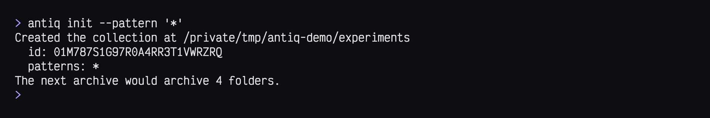
*`init` in the folder `experiments`, which holds six pieces*

`init` changes nothing in your folders and archives nothing. Before the
first real run, the [dry run](#archiving-idle-folders) shows what
`archive` would do.

> [!NOTE]
> The collection keeps its settings in `.antiq/config.toml`. `init` writes
> every setting there with a comment and its default, ready to change.
> [Configuration](#configuration) lists them all. antiq finds the
> collection from any folder inside it, or from the path given with `-C`.

### Which folders are pieces

The **patterns** decide which folders are pieces. They are glob patterns
relative to the collection, given with `--pattern` (once for each) or as
`patterns` in `.antiq/config.toml`:

| Patterns | Pieces |
|---|---|
| `*` (the default) | every folder directly inside the collection |
| `projects/*` | every folder inside `projects`, not `projects` itself |
| `projects/*`, `agents/runs/*` | the folders inside both, nothing else |
| `*/*` | every folder two levels down, such as `2025/tax-report` |

When two patterns match folders inside each other, the outer folder is
the piece. A folder whose name starts with a dot is a piece only if a
pattern names the dot, such as `.notes` or `.*`.

## What is idle

```bash
antiq status
```

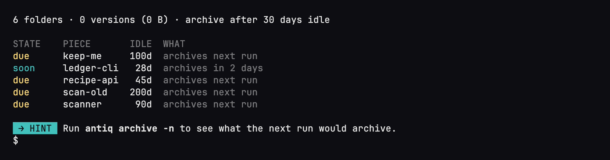
*`status` lists the pieces that have a state*

A piece is due when its idle clock is older than 30 days. The **idle clock** is
the newest modification time of the piece's regular files. Three days
before a piece is due, `status` marks it `soon`, like `ledger-cli` after 28
idle days.
`fresh-idea` has no state, so it is not listed. `status` lists the pieces
that are `due`, `soon`, `pinned` or `refused`, each with the reason.

## Keeping what must stay

`keep-me` is due, but it is a draft you are still using. Pin it:

```bash
antiq pin keep-me
antiq status
```

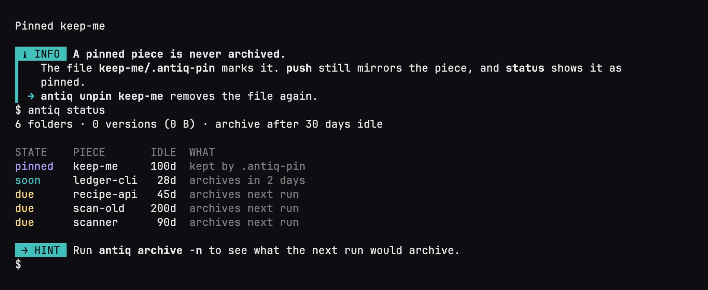
*`pin` keeps `keep-me`, and `status` lists it as pinned*

`pin` creates a `.antiq-pin` file in the piece. A **pinned** piece is never
archived, and `push` still mirrors it. `unpin` removes the file.

More settings in `.antiq/config.toml` keep files out of the way:

| Setting | What it does |
|---|---|
| `collection.ignore` | paths that are neither packed nor counted for the idle check, and `archive` deletes them with the folder (default `[".DS_Store"]`, typical `node_modules/`) |
| `collection.timeless` | paths that are packed but not counted for the idle check, such as `.git/` |
| `collection.exclude` | paths that are never pieces |
| `collection.idle_days`, `collection.soon_days` | the 30 and 3 days |

`ignore` and `timeless` take gitignore lines, `exclude` takes literal
paths. [Configuration](#configuration) lists every setting.

> [!TIP]
> A piece can carry the same gitignore lines in `.antiqignore` and
> `.antiq-timeless` files inside it, the way `.gitignore` files work, for
> rules that concern only that piece.

## Archiving idle folders

Look at what the next run would do before it does it. A **dry run**, with
`-n`, changes nothing:

```bash
antiq archive -n
```

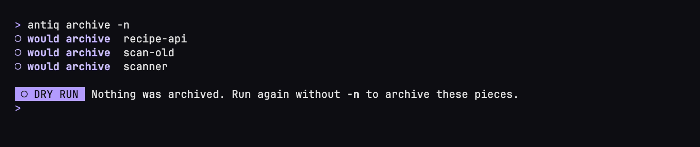
*the dry run lists what the next run would archive*

Now archive. `archive` packs each due piece into an archive, checks that
the archive holds exactly what the folder held, and only then removes the
folder. From then on the piece lives in the archive until you
[bring it back](#bringing-a-version-back):

```bash
antiq archive
```

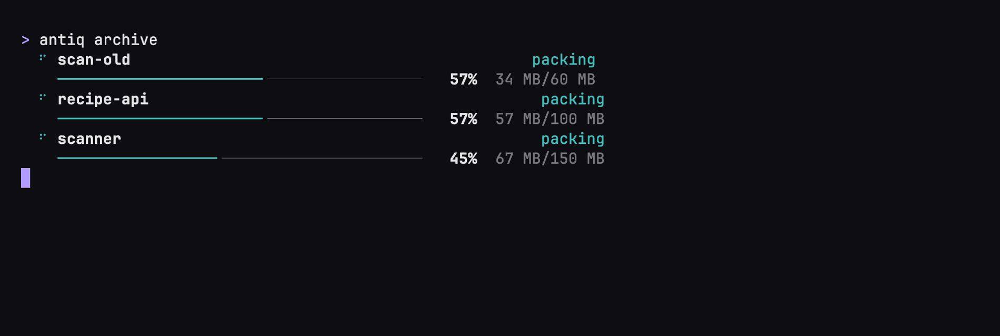
*a card for each piece while it packs*

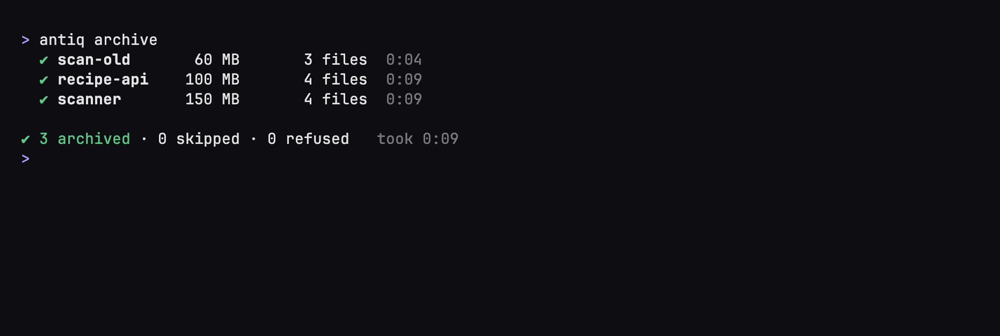
*the finished lines and the closing line*

A folder that changed while it was packed is skipped and stays as it is.
`archive <piece>` archives one piece now, however recently it changed.

> [!NOTE]
> Each archive of a piece is a **version**, named by the time it was
> packed. Most pieces have just one. A second one appears only when the
> same path is archived again while the first is still stored, for
> example after you [forked](#working-on-a-copy) the piece, worked
> on the copy and archived that. The versions then sit side by side, and
> `unearth` and `fork` take the newest unless you name another.

A piece is **refused** and never archived when its folder holds a mount point,
a nested collection, an unreadable or locked entry, an exclude entry, or a
control file that is not a regular file. `status` names the reason. A piece
without a file that counts for the idle check is empty and is not archived
either.

## Finding a version

### What is in the archive

The folders are gone from `experiments`, and their pieces live in the
archive now. `find` shows every archived piece with its versions. Once the
archive has grown, a search word narrows the list down: `find scan` shows
only the pieces whose path fits `scan`. On a terminal with colour, the
letters the search word matched are bold red.

```bash
antiq find
antiq find scan
```

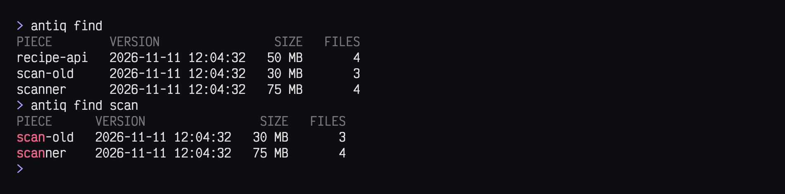
*`find` shows the whole archive, a search word narrows it*

### Searching inside the archives

You remember a file, but not which folder it was in. `grep` searches the
paths of the files in all archives at once, with a regular expression,
and shows the piece and the version that hold each match:

```bash
antiq grep 'main\.rs'
```

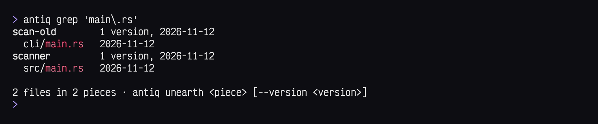
*`grep` finds a file without knowing its folder*

`grep` reads the **listings**, the checksum lists antiq keeps beside each
archive, so nothing is unpacked.

## Bringing a version back

You archived a folder a while ago and need it again. `unearth` takes it
out of the archive: it unpacks the version to the piece's path, checks
that every file arrived, and then removes the version from the archive.
The folder is live again, as if it had never been archived:

```bash
antiq unearth recipe-api
```

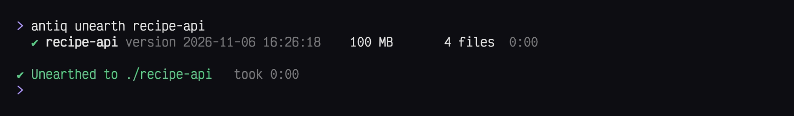
*`unearth` brings `recipe-api` back as a folder*

`unearth` takes the newest version of the piece. `--version` names another
one by a prefix of its time, such as `2026-11-05` or `2026-11-05T00`.

> [!NOTE]
> `unearth` needs the exact path of the piece, since it removes the
> version from the archive. Typed only in part, such as `recipe`, it does
> nothing and lists the pieces that fit, so you can copy the path.

### Working on a copy

To work on an archived folder and keep the archived state as well, use
`fork`. It unpacks a working copy and leaves the version in the archive,
at the piece's path or with `--name <new path>` at another one:

```bash
antiq fork scanner
```

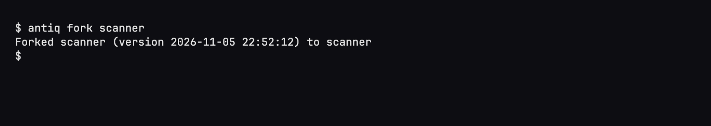
*`fork` unpacks a copy and keeps the version*

Change a file in the copy and archive it again. `archive <piece>` works on
a piece that is not due, and the piece then has two versions side by
side, each taking its own space:

```bash
echo '// edited' >> scanner/src/main.rs
antiq archive scanner
antiq find scanner
```

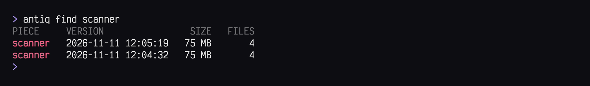
*the two versions of `scanner`*

> [!TIP]
> `fork` does not need the whole path. A part that fits exactly one piece
> is enough, such as `fork recipe` for `recipe-api`. When it fits several,
> antiq lists them. The same goes for every command that deletes no
> version: `archive`, `pin`, `unpin`, `rebuild` and `find`.

### Deleting versions

`forget <piece> <version>` deletes one version, and `forget <piece>
--all-versions --force` deletes all of them. Like `unearth`, `forget` takes
only the exact path of the piece, never just a part of it.

> [!WARNING]
> A forgotten version is gone. antiq deletes its archive from the
> collection, and the next `push` deletes it on the target as well.
> Nothing brings it back.

### Archiving a folder from elsewhere

Old projects also lie outside the collection: on another disk, in a
downloads folder, or packed in archive files from years ago. `import`
puts such a folder into the archive without moving it into the collection
first. It packs the folder as a version, checks the archive the way
`archive` does, and leaves the source folder where it is. On a terminal it
shows the progress card of `archive` while it works:

```bash
antiq import ~/old-disk/pixel-clock
antiq find pixel-clock
```

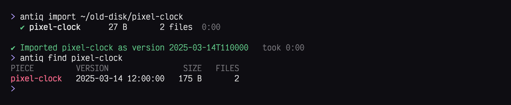
*`import` names the version by the newest file, here from March 2025*

The piece takes the folder's name, or the path given with `--as`, such as
`--as games/pixel-clock`. The [patterns](#which-folders-are-pieces) of the
collection have to select that path. The version is named by the time of
the newest file in the folder, so a project last changed in March 2025
becomes a version from March 2025. `--time` gives it another time. The
collection's ignore and timeless rules apply to the folder as they do to
a piece.

> [!TIP]
> Old archive files go in the same way. Unpack each one into a temporary
> folder with the files' original times, as `tar` and `unzip` keep them,
> and import the folder that comes out.

## Mirroring

The archive lives in the collection's `.antiq/` folder, on the same disk
as the live folders. When that disk dies, both are gone. `push` copies the
whole collection, the live folders and the versions, to one **target** on
another disk or a NAS, and on every later run brings the target to the
state of the collection again.

### Two ways to mirror

`push` copies with rsync, and it can reach the target in two ways.

**To a folder on this machine.** The target is a path, such as
`/Volumes/Backup/antiq`: a folder on an external disk, or on a network
share that is mounted here. rsync runs on this machine alone and writes
into the folder as into any other.

**To another machine over ssh.** The target is an ssh address, such as
`backup@nas.local:/volume1/antiq`. rsync logs in to the NAS or server
over ssh and starts a second rsync there, which writes to that machine's
own disk.

For a NAS, ssh is the better choice. A share mounted over SMB or NFS
handles many small files slowly, and the live folders are full of them.

> [!NOTE]
> Both ways need rsync 3.2.4 or newer on this machine, as
> [Installation](#installation) describes. Over ssh the other machine needs
> rsync too, ideally 3.2.4 or newer as well: with its `--fsync`, every file
> is on the target's disk before rsync counts it as written. If the first
> `rsync` on that machine's `PATH` is an older one, name the newer one with
> `rsync_path` in the `[target]` block. Only where no such rsync can be
> installed, such as on a Mac with its openrsync, set `fsync = false`.
> A power loss on the target during a push can then leave files empty or
> missing there, and antiq does not read the target back to notice.

### Setting up a target

Create an empty folder on the target, add a `[target]` block with its
`url` to `.antiq/config.toml`, and let `push --init` claim the folder.
For a disk mounted at `/Volumes/Backup`, with an empty folder `antiq` on
it:

```toml
[target]
url = "/Volumes/Backup/antiq"
```

```bash
antiq push --init
```

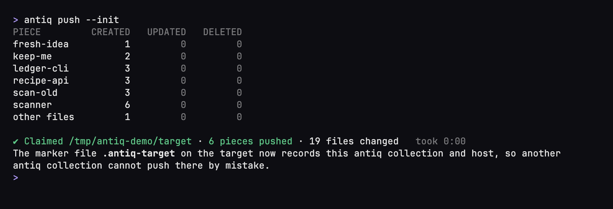
*the first push claims the target*

`--init` wrote the **marker** `.antiq-target` at the target's root. It
holds the collection ID, the machine name and the collection path, and
keeps another collection from pushing there by mistake. `push --take-over`
rewrites its machine name and path (see the FAQ). From then on,
`antiq push` mirrors the collection, and `push -n` lists what would change
without changing anything.

An ssh target is set up the same way, with its address as the `url`:

```toml
[target]
url = "backup@nas.local:/volume1/antiq"
```

ssh options such as a port or a key go into `~/.ssh/config`.

> [!TIP]
> Some mounted shares do not let rsync set file modes, and `push` then
> fails with "the target does not let rsync set file modes". Only in that
> case, tell rsync to leave the modes alone:
>
> ```toml
> [target]
> rsync_args = ["--no-perms"]
> ```
>
> The files in the live folders on the target then get the share's own
> modes instead of their real ones, while the archived versions keep
> theirs. Leave the setting out as long as `push` works without it.

> [!WARNING]
> The target is a mirror, not a backup: whatever is deleted in the
> collection is deleted on the target by the next push.
> The [FAQ](#faq) says more.

### When a push fails

A push that fails names the log of the run, a compressed file with
everything rsync printed. On macOS the logs are in `~/Library/Logs/antiq`,
elsewhere in `antiq` in the state directory, and the error shows the
command that reads one: `zstd -dc <path> | less`. antiq keeps the 10
newest logs of a collection, and the newest log of a failed push beyond
them.

## Running unattended

antiq does nothing on its own. Folders move into the archive when you run
`archive`, and the target catches up when you run `push`. Running both now
and then by hand is enough. If you would rather not think about it, let a
scheduler such as cron, launchd or a systemd timer run them, every night
for example. Idle folders then go into the archive by themselves, and the
mirror stays current. No command asks a question, so nobody has to sit at
the keyboard:

```bash
antiq -C ~/experiments archive; antiq -C ~/experiments push --if-reachable
```

`--if-reachable` is for a laptop that is not always near its target. When
the backup disk is not plugged in or the NAS is out of reach, the push is
skipped and exits 0 instead of 4, so the run counts as a success. A held
lock, a damaged version or any failure after the target was reached still
exits 1, so real problems still show. The push runs even when the archive
skipped some pieces, and the scheduler sees only the push's exit status.
[Exit codes](#exit-codes) lists them all.

## Damaged versions

Normally you never run into this. Each version is three
files in `.antiq/pieces/<piece>/`: the archive, its listing and its
checksum file. When one of them goes missing or is changed from outside
antiq, the version is **damaged**. That happens when a file is deleted by
hand, when a copy back from the [mirror](#mirroring) stops halfway, or after a disk
error. antiq's own crashes do not cause it, because the next run cleans
up after them.

You notice a damaged version in three places: `status` reports it, `find`
marks it, and `push` refuses to run until it is repaired. Here the listing
of `scan-old` is missing:

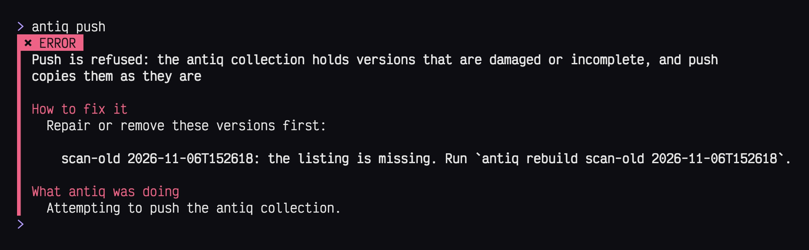
*a damaged version stops `push`, and the error names the repair*

What helps depends on what is missing, and the error names the command:

- **The listing or the checksum file is missing.** `rebuild` writes it
  again after checking the archive against what survives.
- **The archive is missing**, and only its listing or checksum file is
  left. The version is **incomplete**, and nothing can rebuild its files.
  Copy the archive back from the mirror if it is there, or let `forget`
  remove the version.
- **A file is there but broken.** Copy it back from the mirror, or let
  `forget` remove the version.

Here `rebuild` repairs `scan-old`:

```bash
antiq rebuild scan-old 20
```

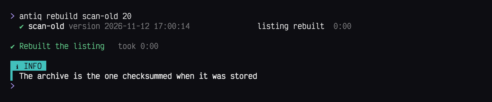
*`rebuild` writes the missing listing*

The version argument is a prefix of the version's time, so `20` is the one
version here.

## Reading archives without antiq

Everything antiq stores is in plain formats that standard tools read. Your
versions do not depend on antiq: without it, `tar`, `zstd` and `shasum`
get every file back and check it.

Each piece has a folder in `.antiq/pieces/`, named by the piece's path.
Each version in it is three files that share one name, made of the
piece's name and the version's time in UTC:

```text
.antiq/pieces/scan-old/
  scan-old--2026-11-05T150201.tar.zst          the archive
  scan-old--2026-11-05T150201.tar.zst.sha256   the checksum file
  scan-old--2026-11-05T150201.sha256.zst       the listing
```

**The archive** is a tar file compressed with zstd. It holds one folder,
named like the piece's folder when it was packed, with the files inside.
`zstd -dc <archive> | tar -x` unpacks it.

**The checksum file** holds one line, the SHA-256 of the archive and its
file name, in the format `shasum` reads. `shasum -a 256 -c <checksum
file>`, run in the piece's folder, checks that the archive is unchanged.

**The listing** is a checksum list of every file in the archive,
compressed with zstd. antiq's details about the version and about each
entry (type, mode, time and size) are comment lines starting with `#`,
which `shasum` skips. `zstd -dc <listing>` shows it. Piped into `shasum -a
256 -c -` inside the unpacked folder, it checks every file. Use `shasum`
for this: the `sha256sum` that macOS ships is not GNU's and fails on a
listing.

## Using antiq in scripts

On a terminal antiq draws progress cards and colours, as in the images
above. When its output goes into a pipe or a file, it prints plain lines
instead, such as one line per piece and a summary for `archive`. `find` and `grep`
print one tab-separated line per version or match, ready for `cut` or
`sort`.

For a script that must know exactly what happened, every command takes
`--json` and then prints its whole result as one JSON object, errors
included. No command ever asks a question, so nothing waits for input.

### Exit codes

| Exit | Meaning |
|------|---------|
| 0 | success |
| 1 | error, a held lock included |
| 2 | usage error |
| 3 | partial: a step failed for some pieces, or an `unearth` or `fork` that did not finish |
| 4 | target unreachable (`push` only) |

## Reference

### Commands

```text
$ antiq --help
Your idle folders, kept like antiques

Usage: antiq [OPTIONS] <COMMAND>

Commands:
  init     Make a directory a collection
  status   Show the pieces that have a state
  archive  Archive due pieces, or one piece now
  unearth  Bring a version back and remove it
  fork     Extract a working copy of a version
  forget   Delete a version, or all of them
  rebuild  Repair a damaged version
  import   Pack a folder as a version
  find     Find and list the versions of pieces
  grep     Search the paths of all archived files
  pin      Keep a piece from being archived
  unpin    Let a piece be archived again
  push     Mirror the collection to the target

Options:
  -C <PATH>      Run as if started in this directory
      --json     Print the result as one JSON object and never ask a question
  -h, --help     Print help
  -V, --version  Print version
```

Every command takes `-C <path>` and `--json`. Commands that change
something take `-n` / `--dry-run`, which prints the plan and changes
nothing. `antiq --version` prints the version on one line, and on a
terminal with 24-bit colour it draws Archie beside it.

### Configuration

The configuration is `.antiq/config.toml`. `init` writes it with a
comment for every key, and with every key but the collection ID (and
`patterns`, when `--pattern` is given) commented out at its default.

| Key | Default | Content |
|-----|---------|---------|
| `collection.id` | minted at `init` | collection ULID, also written to the target's marker |
| `collection.patterns` | `["*"]` | glob patterns that select pieces, the shallowest match wins ([examples](#which-folders-are-pieces)) |
| `collection.exclude` | `[]` | literal paths that are never pieces |
| `collection.ignore` | `[".DS_Store"]` | gitignore lines for paths that are not packed, not listed and not counted for the idle check |
| `collection.timeless` | `[]` | gitignore lines for paths that are packed but not counted for the idle check, such as `.git/` |
| `collection.idle_days` | 30 | days a piece must be idle before it is due |
| `collection.soon_days` | 3 | days before due from which `status` shows a piece as `soon` |
| `target.url` | none | an absolute path or `[user@]host:path` |
| `target.rsync` | the first suitable `rsync` on `PATH`, then in `/opt/homebrew/bin` and `/usr/local/bin` | absolute path of the local rsync |
| `target.rsync_path` | none | the rsync on the target, passed as `--rsync-path` |
| `target.fsync` | `true` | pass `--fsync` to rsync |
| `target.rsync_args` | `[]` | extra rsync options, one string each |

## FAQ

**Is the mirror a backup?** No. `push` makes the target a copy of the
collection as it is now, and keeps no history. Whatever is deleted in the
collection, by antiq or by hand, is deleted on the target by the next
push.

**What does `push` copy?** The whole collection: the live folders, pinned
ones included, the versions and everything else in it. Left out are
antiq's temporary folders and its lock, and the folders macOS keeps at
the root of a volume.

**Why is a folder I unearthed not archived again right away?** `unearth`
and `fork` write the time into the folder they create, and the idle clock
counts from the later of that time and the newest file. The folder gets
the full 30 days again, even when its files are years old.

**What does a version not keep?** Extended attributes, ACLs, access times
and creation times are kept neither in versions nor on the target. Hard
links are kept in versions and in the mirror. Copying the target back
keeps them only with `rsync -aH`. Sparse files are stored in full and
come back fully allocated.

**What happens to symlinks?** A symlink is archived and restored as it is,
whatever it points to. On the target it is copied as a symlink and points
to whatever its path names there.

**Does `push` notice damage on the target?** No. rsync checks a
whole-file checksum of each file it sends. A file whose size and
modification time match is not sent and not compared, so damage on the
target stays unseen. antiq reads nothing back from the target.

**`push` says the target is unreachable, but the disk is mounted.** A path
target that does not exist, or an empty folder without a marker, counts
as unreachable. Create the folder and run `push --init` once. antiq never
creates the folder of a path target; over ssh `push --init` creates the
last missing level. A path target must be a folder on the volume, not the
volume's root, and must not lie inside the collection.

**`push` refuses after I renamed the machine or moved the collection.**
The marker on the target records the machine name and the collection
path, and `push` refuses when either differs, naming both. `antiq push
--take-over` rewrites the marker to this machine and this path and then
pushes; the next `push` needs no flag. Pushing with `--force` each time
works too and leaves the marker as it is. A target whose marker belongs to
another collection is refused, also with `--take-over`. After a take-over
the machine or path the marker named before is refused, a scheduled `push
--if-reachable` included, and any copy of the collection with the same ID
can take the target over.

**I renamed a folder only in case.** On a case-insensitive target the
renamed folder is copied in a second pass. The target must be as strict
about names as the collection's volume. `push` refuses while two piece
paths differ only in case or Unicode normalization. File names inside one
live folder that differ only in case are not checked.

**A directory in the collection became a mount point.** `push` stays on
the collection's device. The directory arrives on the target empty, and
the files it held before are deleted from the target.

**`push` says no deletion reached the target.** rsync could not open a
directory of the collection, and then it deletes nothing on the target at
all. `push` names the directories. Once they are readable, the next push
deletes again.

<!-- docs:end -->

## Development

The tests need rsync 3.2.4 or newer, found in `PATH`,
`/opt/homebrew/bin` or `/usr/local/bin`, `shasum`, and a GNU
`sha256sum`. brew's coreutils on macOS name it `gsha256sum`, Ubuntu's
gnu-coreutils from 25.10 on `gnusha256sum`. The tests fail with a message
naming the missing tool.

The tasks live in the `Justfile` (`just --list` shows them). `just check`
runs `cargo fmt --check`, `cargo clippy --all-targets -- -D warnings` and
`cargo test`. The last commit of a change has to pass it before it reaches
`main`.

Coverage needs `cargo-llvm-cov`. After a change, `just coverage
<base-commit>` lists the changed lines under `src/` that no test runs.

`docs/specs/spec-v1.md` specifies version 1, `docs/adrs/` records the
decisions behind it and `docs/research/` the research. Deferred work is
in the todo vault at `todos/`.

The images of this README and of the project page are rendered from real
runs of antiq in a demo world. `just shots` renders them again into
`docs/pages/assets/shots/`. It needs `vhs`, `ttyd`, `ffmpeg`, `oxipng`, an
rsync of 3.2.4 or newer and the font Victor Mono installed (the file is
`assets/social/fonts/VictorMono-Variable.ttf`). `just demo-video` renders
only the demo video (`docs/pages/assets/demo.webm` and `demo.mp4`) and the
GIF at the top of this README. `just shots-test` tests the script that
builds the demo world.

## About the name

The pangolin in the logo is [Archie](assets/archie-512.webp), antiq's
mascot: a small idol of obsidian and gold. Archie shares its name with
the first internet search engine, released in 1990, which indexed the
files on FTP archives so people could find them again. The search
engine's name, too, was a shortening of "archive".

## License

Mozilla Public License 2.0, see [LICENSE](LICENSE).
